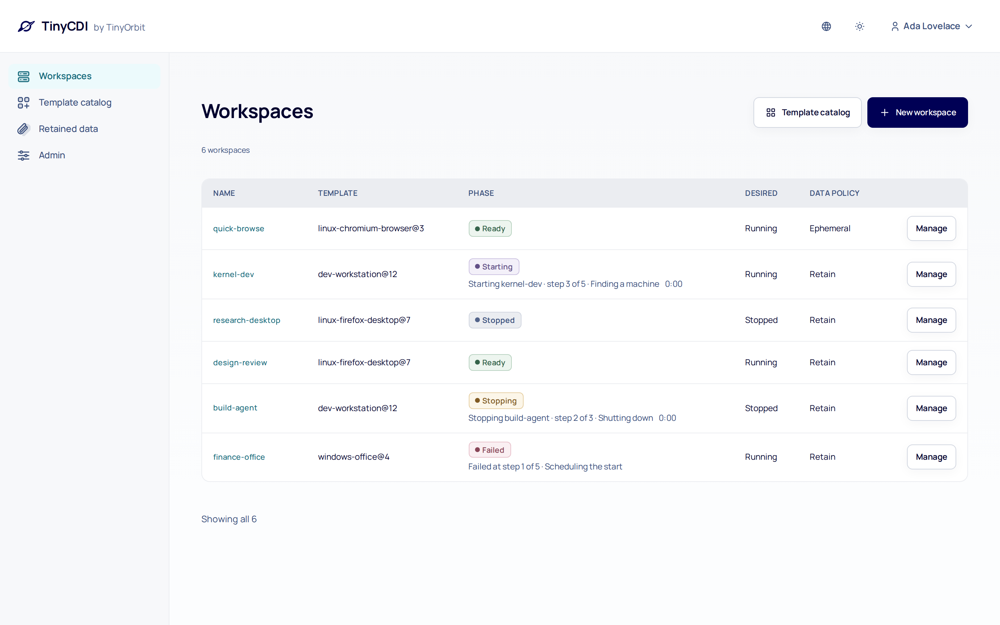
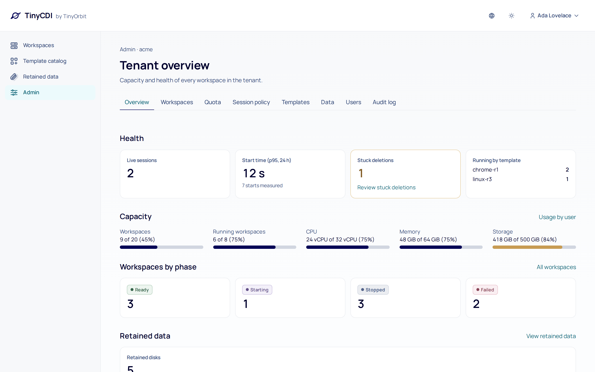
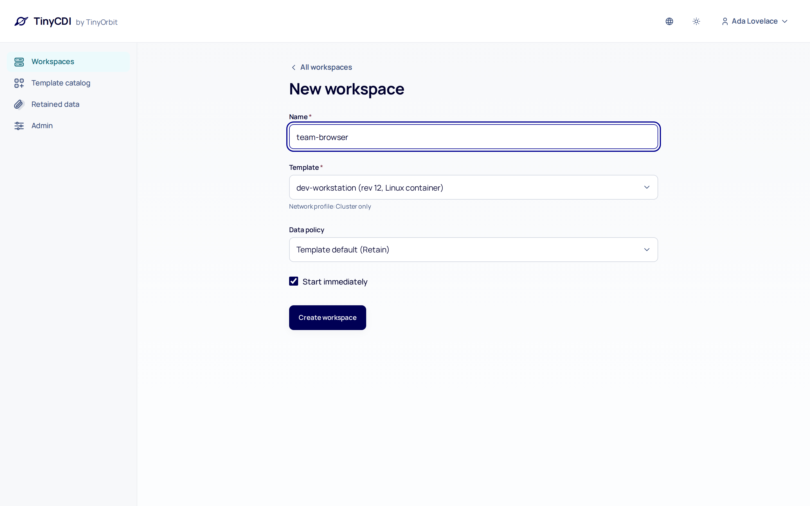
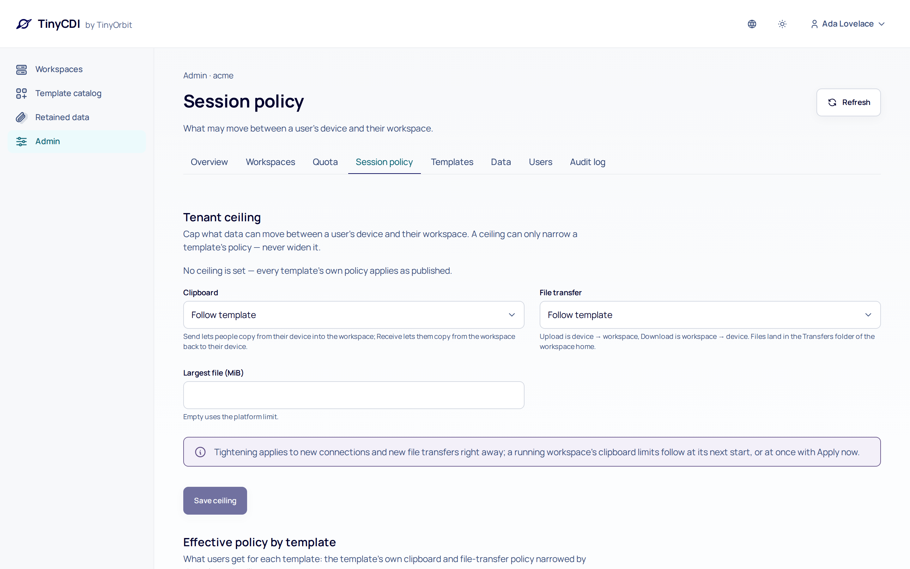
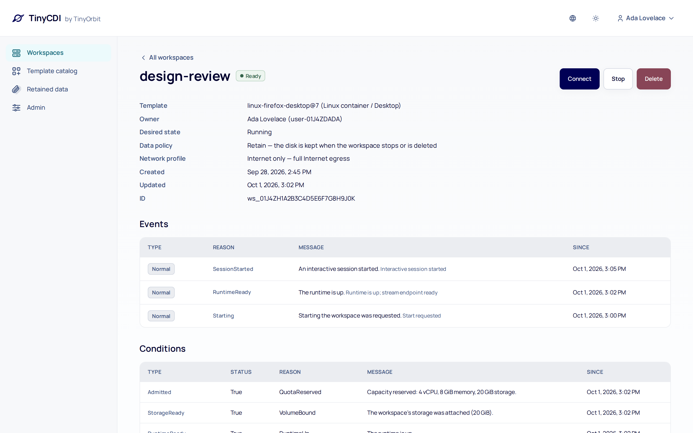
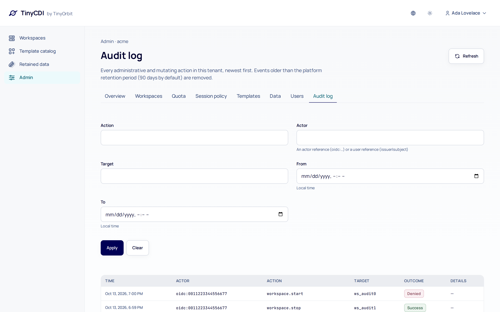
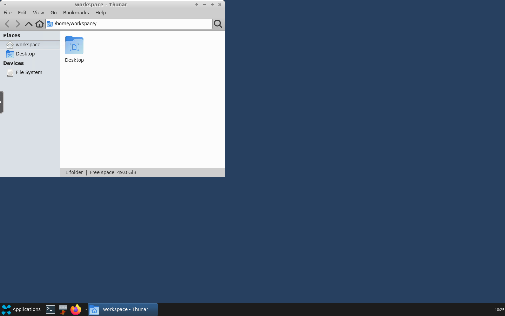
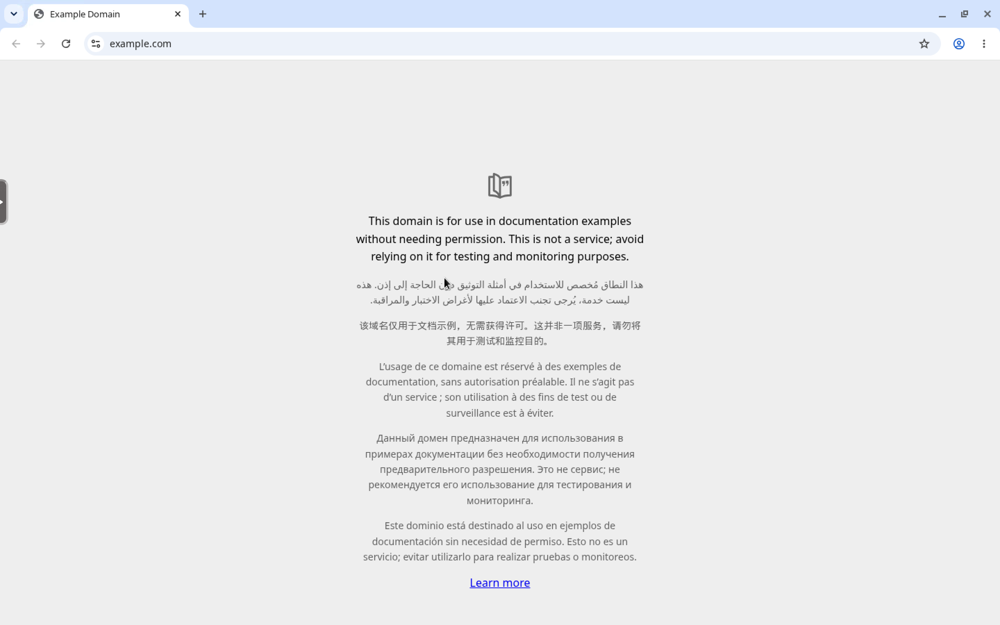

# TinyCDI

[](https://github.com/tinyorbitvn/tinycdi/actions/workflows/ci.yml)
[](https://github.com/tinyorbitvn/tinycdi/releases)
[](LICENSE)

TinyCDI is a self-hosted platform that gives users disposable Linux desktop
and browser workspaces on Kubernetes — streamed straight into their browser
over KasmVNC. It exists for teams that want Kasm-style remote desktops
without the Kasm Workspaces control plane: a small Go backend (API,
session gateway and broker in one binary), an operator that reconciles
`Workspace` CRDs into locked-down pods, and a React portal on top. The Windows desktop track (KubeVirt +
Guacamole/RDP) is deferred pending its own proof gate.

## Architecture

The control plane runs three Deployments, as described in
[ADR 0005](docs/adr/0005-backend-frontend-operator.md): the **backend**
(public REST API, session gateway and the in-process session broker on
separate app, session, internal-mTLS and optional metrics listeners), the
**frontend** (the static SPA with browser security headers; it does not
proxy `/v1`) and the **operator** (`Workspace`/`WorkspaceTemplate` CRDs).
Users see one URL, and each workspace is served on its own
`<label>.<sessionDomain>` host so parallel sessions stay isolated.
Details: [docs/architecture.md](docs/architecture.md).

## Features

- **Desktop & browser workspaces in the browser** — Linux desktop and
  ephemeral Chromium/Firefox sessions streamed over KasmVNC WebSocket
  (HTTPS, no client install). Each workspace is served on its own
  `<label>.<sessionDomain>` host.
- **Self-service portal** — users create, start, stop and delete
  workspaces from the templates their tenant offers, and follow each
  start step by step.
- **Persistent / retained home data** — Retain or Ephemeral data policy
  per workspace; retained disks can be re-attached to a new workspace or
  purged.
- **Clipboard and file transfer** — within the ceiling the tenant sets;
  one file at a time through the workspace's `~/transfers` folder.
- **Sign out everywhere** — ends every portal session a user holds in the
  tenant and revokes that tenant's live desktop connections and
  outstanding launch tickets.
- **Admin console** — tenant admins see an overview of capacity and
  health, and manage workspaces, templates, retained data, users (with
  their live sessions), quota and per-user limits across the tenant.
- **Session policy** — a tenant-wide clipboard and file-transfer ceiling
  over each template's own policy; `:apply` restarts running workspaces
  that are looser than the ceiling, after a dry run lists them.
- **Audit log** — admin and session actions are persisted in PostgreSQL,
  browsable in the admin console and pruned after a retention period
  (default 90 days).
- **OIDC SSO with a group gate** — users authenticate through your
  identity provider; only allowed groups get in.
- **One-use launch tickets + hardened session gateway** — opaque,
  TTL-bound, single-use tickets redeem at a separate session origin that
  enforces launch-origin policy and reverse-proxies to the runtime.
- **Kubernetes operator** — `workspaces.cdi.tinyorbit.vn` CRDs
  (`Workspace`, `WorkspaceTemplate`) reconcile pods, PVCs and lifecycle.
- **Isolation by default** — per-workspace NetworkPolicy/egress profiles,
  Localhost seccomp + AppArmor node profiles, non-root runtime with all
  capabilities dropped, and Chromium's sandbox kept *on*.
- **Helm chart** — one-command install/upgrade, CRDs, RBAC and
  NetworkPolicy baseline included.
- **Local trial** — `hack/quickstart/up.sh` brings TinyCDI up on a
  throwaway local cluster ([quickstart](docs/quickstart.md)).
- **Signed releases** — images on `ghcr.io` with SBOMs, SLSA provenance
  and signature verification (see `docs/security/provenance.md`).

## Screenshots

| Workspace portal | Tenant admin |
|---|---|
| <picture><source media="(prefers-color-scheme: dark)" srcset="docs/images/screenshots/portal-workspaces-dark.png"></picture> | <picture><source media="(prefers-color-scheme: dark)" srcset="docs/images/screenshots/admin-overview-dark.png"></picture> |
| <picture><source media="(prefers-color-scheme: dark)" srcset="docs/images/screenshots/portal-create-dark.png"></picture> | <picture><source media="(prefers-color-scheme: dark)" srcset="docs/images/screenshots/admin-session-policy-dark.png"></picture> |
| <picture><source media="(prefers-color-scheme: dark)" srcset="docs/images/screenshots/portal-detail-dark.png"></picture> | <picture><source media="(prefers-color-scheme: dark)" srcset="docs/images/screenshots/admin-audit-dark.png"></picture> |
|  |  |

Screenshots are real captures of the shipped portal (light and dark
follow your GitHub theme) and runtime images. Regenerate them with
`node web/scripts/screenshots.mjs` (see `docs/development.md`).

## Quick start

Requires a Kubernetes cluster (≥ 1.30) with NetworkPolicy enforcement, a
PostgreSQL database, an OIDC provider and a StorageClass for retained
data. Install the published chart:

```sh
helm install tinycdi oci://ghcr.io/tinyorbitvn/charts/tinycdi \
  -n tinycdi-system --create-namespace -f my-values.yaml
```

Start from `deploy/helm/tinycdi/ci/example-values.yaml`, then follow the
full procedure — secrets, TLS, node profiles — in
[`docs/runbooks/install.md`](docs/runbooks/install.md). Chart reference:
[`deploy/helm/tinycdi/README.md`](deploy/helm/tinycdi/README.md).
Unmodified `kasmweb/*` workspace images can also run through the injected
adapter (`spec.linux.adapter: kasm`) — see [`docs/kasm-images.md`](docs/kasm-images.md).

## Documentation

- [Documentation index](docs/README.md)
- [Architecture](docs/architecture.md) — design doc + ADRs
- [Runtime image contract](docs/images.md) · [Compatibility pins](docs/compatibility.md)
- [Runbooks](docs/runbooks/install.md) — install, retained data, DR, capacity, audit
- [Versioning](docs/versioning.md) — the 1.0 contract: stable surfaces and support policy
- [Development](docs/development.md) — repo layout, build, test, screenshots
- [Contributing](CONTRIBUTING.md) — CI checks and how changes are proposed

## Security

TinyCDI runs other people's desktops — vulnerability reports go through
GitHub private reporting, and hardening rules are mandatory for
contributors and operators. See [`SECURITY.md`](SECURITY.md).

**Status:** TinyCDI 1.0 — see the [release notes](docs/releases/v1.0.1.md) and [known limitations](docs/releases/v1.0.0.md#known-limitations). Maintained by one person. The maintainers' internal [security review](docs/security/review-v1.0.md) of 1.0.0 is complete; no independent security audit has been done. Report vulnerabilities per [SECURITY.md](SECURITY.md).

## License

MIT — see [`LICENSE`](LICENSE). Third-party notices: [`NOTICE`](NOTICE),
[`THIRD_PARTY_LICENSES.md`](THIRD_PARTY_LICENSES.md). The runtime images
redistribute KasmVNC under GPL-2.0 — the corresponding-source offer is in
[`SOURCE-OFFER`](SOURCE-OFFER).

TinyCDI is an independent project, not affiliated with or endorsed by
Kasm Technologies, Google or the Mozilla Foundation. "KasmVNC"/"Kasm",
"Chromium"/"Chrome" and "Firefox" are trademarks of their respective
owners, used only to identify third-party components.
